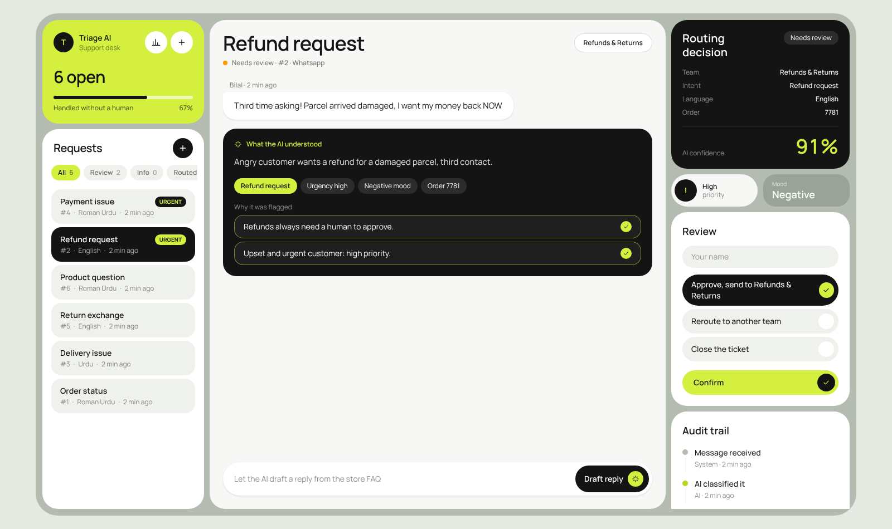

# Triage Desk

**An AI support inbox for online stores in Pakistan and the Gulf.**
Customer messages arrive in English, Urdu or Roman Urdu. Triage Desk reads each
one, works out what the customer wants, routes it to the right team, and sends
anything uncertain to a human, with a full audit trail of every decision.

> Status: in active development. Backend, migrations, suggested replies and the
> eval are done; the review dashboard and deployment are next.

## How a message is handled

1. **Received:** saved immediately, so a customer message is never lost.
2. **Classified by AI:** intent, urgency, sentiment, language, order number and a
   one-line summary. The output must match a strict Pydantic schema; invalid
   output is retried once, then the ticket goes to a human.
3. **Routed by rules:** deterministic rules decide the team and status. The AI
   suggests; the rules decide.
4. **Reply drafted (on request):** the AI drafts a reply in the customer's own
   language using only the store FAQ, and cites the entries it used. A human
   approves or edits it before anything is sent.
5. **Audited:** every step (received, classified, routed, flagged, reviewed) is
   stored with the actor, the model and the prompt version.

### Rules

The team always comes from the intent, so the team that can actually fix the
problem owns the ticket. An early test with real messages showed that moving
upset customers to an "Escalations" team took payment and refund problems away
from the people who could solve them, so urgency now raises **priority**
instead of changing the team.

| Rule | Effect |
|---|---|
| AI confidence below 0.7 | Needs review (`low_confidence`) |
| Refund request | Always needs human approval (`refund_needs_approval`) |
| Negative sentiment and high urgency | High priority and needs review, but stays with the team that owns the problem (`angry_and_urgent`) |
| High urgency (any sentiment) | High priority |
| Intent is a complaint | Escalations team |
| Order or delivery question with no order number | Needs info (`missing_order_id`) |
| AI unavailable or invalid output twice | Kept, sent to a human (`ai_unavailable`) |

## Suggested replies

- **Search:** the store FAQ (`data/faq.json`, a fictional store) is searched with
  BM25 keyword ranking on the AI's English summary of the message, so Urdu and
  Roman Urdu messages find the same FAQ entries as English ones. The FAQ has
  under 20 entries, so keyword ranking is enough and keeps the app small.
- **Drafting:** the AI writes in the customer's language (English, Roman Urdu or
  Urdu script), may use only the FAQ entries it was given, and must not promise
  refunds or invent order details. If the FAQ does not cover the question, it
  says a team member will follow up and marks the draft as not covered.
- **Guardrail in code:** a draft that cites an FAQ entry it was not given is
  rejected and retried once.
- **Human approval:** the reviewer approves the draft or edits it first; the
  audit log records who approved it and whether it was edited.

## API

| Method | Path | What it does |
|---|---|---|
| POST | `/api/enquiries` | Submit a customer message |
| GET | `/api/tickets?status=&team=&priority=` | List tickets, high priority first |
| GET | `/api/tickets/{id}` | Ticket with its full audit trail |
| POST | `/api/tickets/{id}/review` | Human approves, reroutes or closes |
| POST | `/api/tickets/{id}/suggest-reply` | AI drafts a reply from the FAQ |
| POST | `/api/tickets/{id}/reply/approve` | Human approves (optionally edited) reply |
| GET | `/api/faq` | The store FAQ |
| GET | `/api/stats` | Counts by status, intent, language and team |
| GET | `/api/health` | Health, model and prompt version |

## Run locally

Requires Python 3.11.

```bash
python -m venv venv && source venv/bin/activate
pip install -r requirements-dev.txt
cp .env.example .env          # then set GROQ_API_KEY
alembic upgrade head          # create or update the database tables
python -m uvicorn app.main:app --port 8000
```

API docs: <http://localhost:8000/docs>. Try it with sample messages:

```bash
python scripts/try_messages.py            # classification and routing
python scripts/try_messages.py --replies  # plus a drafted reply for each
```

## Dashboard



A Next.js + Tailwind workspace in `frontend/` for the support team, one screen with three columns:

- **Requests**: every ticket with status filters, urgent ones marked, and a live count of how many were handled without a human.
- **Conversation**: the customer message (Urdu shown in Nastaliq, right to left), what the AI understood, why the rules flagged it, and the AI's suggested reply with the FAQ entries it used. Edit the draft and approve it in place.
- **Decision**: the routing, AI confidence, review actions (approve, reroute, close) and the full audit trail.
- **Analytics** (`/analytics`): tickets by intent, language, team and status.

Run it in a second terminal while the API runs (needs Node 20+):

```bash
cd frontend
npm install
cp .env.example .env.local    # NEXT_PUBLIC_API_URL, default http://localhost:8000
npm run dev                   # http://localhost:3000
```

## Eval

`eval/messages.jsonl` holds 60 labelled messages: 20 English, 20 Roman Urdu and
20 Urdu script, across all 8 intents. With the API running:

```bash
python eval/run_eval.py
```

It reports intent, team and language accuracy per language and lists every
miss.

**First full run** (Groq `openai/gpt-oss-120b`):

| Language | Intent | Team | Language detected |
| --- | --- | --- | --- |
| English | 20/20 (100%) | 20/20 (100%) | 20/20 (100%) |
| Roman Urdu | 18/20 (90%) | 18/20 (90%) | 20/20 (100%) |
| Urdu | 20/20 (100%) | 20/20 (100%) | 20/20 (100%) |
| **All** | **58/60 (97%)** | **58/60 (97%)** | **60/60 (100%)** |

Both misses were Roman Urdu and both are close calls rather than clear errors:
"Card se do dafa paise kat gaye" (charged twice) was read as a refund request
instead of a payment issue, and "Kya Lahore mein aap ki koi shop hai?" (do you
have a shop in Lahore) was read as a product question. The prompt was not
tuned to these two cases, to avoid fitting the eval set.

### Found by testing with real messages

- **Escalation rule:** upset customers were being moved to an Escalations team,
  away from the team that could fix their problem. Urgency now raises
  priority instead.
- **Reply language:** an Urdu message hit a rate limit during classification,
  and its drafted reply came back in English. The reply language now falls
  back to detecting Urdu script in code.

## Tests

```bash
python -m pytest -q
```

36 tests, including one that builds the database from the migrations and
guardrail tests for the reply drafter. The AI
and the database are replaced with fakes, so no API key or internet is needed.

## Stack

FastAPI · Next.js · Tailwind · SQLAlchemy 2 · Alembic · PostgreSQL (SQLite locally) · Groq · Pydantic · pytest ·
GitHub Actions
